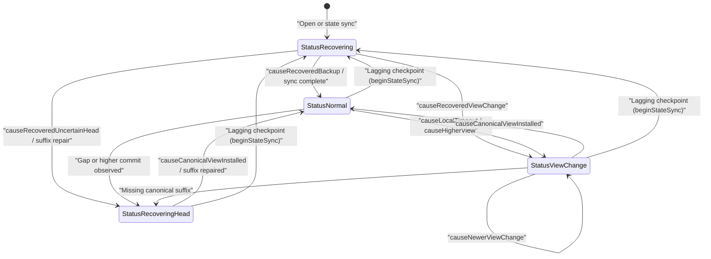
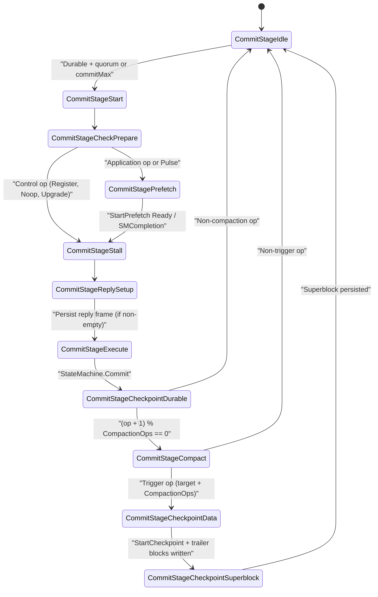

# supervsr

Viewstamped Replication (VSR) consensus, WAL storage, and block checkpointing in Go.

`supervsr` is a replicated state-machine engine modeled on TigerBeetle's VSR design. It injects storage, networking, clocks, randomness, and application execution through interfaces so production servers and deterministic fault simulations run the same state transitions. Callers supply their own network transport, authenticating and forwarding `protocol.Frame` buffers through `MessageBus` and `Replica.Submit`.

- **Cluster topology**: 1 to 6 active replicas plus up to 6 standbys (`MembersMax = 12`) with validated quorum intersection.
- **Single-file layout**: Preallocated replica file holding 4, 6, or 8 superblock copies, WAL header rings and prepare slots, client reply slots, and block-addressed checkpoints.
- **Platforms and storage**: Go 1.27.4+ with platform-native `FileStorage` on Linux (`O_DIRECT`, `fallocate`), macOS (`F_NOCACHE`, `F_FULLFSYNC`, `F_PREALLOCATE`), Windows (`FILE_FLAG_NO_BUFFERING | FILE_FLAG_WRITE_THROUGH`, `FileAllocationInfo`, `FlushFileBuffers`), and portable buffered fallback on other OSes.
- **Checksums**: 128-bit `ChecksumAEGIS128L` by default (hardware AES on x86-64/ARM64 with automatic portable fallback, plus opt-in `RequireHardwareChecksum` on `FormatConfig` and `ProcessConfig`) or `ChecksumWyhash128` (`ClusterConfig.ChecksumAlgorithm`), bound into the superblock configuration fingerprint.
- **Dependencies**: Only `github.com/rs/zerolog` and `golang.org/x/sys`.

```sh
go run ./cmd/toykv -data ./toykv-data -replicas 3
# toykv> put hello world
# OK
# toykv> get hello
# world
```

## Install

```sh
go get z.gfire.dev/supervsr@latest
```

## Quick start

Run the included in-process key-value demo (`cmd/toykv`) from a repository checkout to format and start a local 3-replica cluster:

```sh
git clone https://github.com/gfire-sigs/supervsr.git
cd supervsr
go run ./cmd/toykv -data ./toykv-data -replicas 3 -pretty-logs
```

Enter `put KEY VALUE`, `get KEY`, `delete KEY` (`del`), or `quit` at the prompt. Pass `-checksum wyhash` when formatting to use `ChecksumWyhash128` instead of the default `aegis` mode. Reopening an existing `-data` directory requires the same `-replicas` count and `-checksum` mode stored in `cluster.json`.

## Features

- Pipelined consensus (`PipelineMax` up to 15) with `ExitView`, `JoinView`, and `View` failover, canonical suffix selection, and log truncation.
- Exactly-once client sessions with request hash chaining, durable reply caching, and cross-replica reply repair.
- Incremental compaction boundaries (`CompactionOps`), block-addressed checkpoints via `CheckpointBlockTransaction`, and peer state sync when a replica lags behind retained WAL.
- Background storage scrubbing (`ScrubCycle`) and `ReplaceLostReplica` for fencing failed nodes before formatting replacements.
- Deterministic fault simulator in `replication/sim` covering network partitions, clock drift, storage faults, controlled I/O scheduling, and per-step invariant checks.

## Usage

Embedding `supervsr` takes four steps: implement `replication.StateMachine`, format a replica file with `replication.Format`, open and recover it with `replication.Open`, and run `Replica.Run`. Clients connect through `replication.ManagedClient` for goroutine-safe `Register` and `Submit` calls, or through `replication.Client` in single-threaded event loops.

```go
package main

import (
	"context"
	"crypto/rand"
	"fmt"
	"os"
	"path/filepath"
	"time"

	"z.gfire.dev/supervsr/replication"
	"z.gfire.dev/supervsr/replication/protocol"
)

type noopBus struct{}

func (noopBus) SendReplica(protocol.ReplicaIndex, *replication.Message) {}
func (noopBus) SendClient(protocol.ClientID, *replication.Message)      {}
func (noopBus) BroadcastReplicas(*replication.Message)                  {}

type systemClock struct{ start time.Time }

func (c systemClock) Now() replication.TimeSample {
	now := time.Now()
	return replication.TimeSample{
		Wall:         uint64(now.UnixNano()),
		Monotonic:    uint64(now.Sub(c.start)),
		Synchronized: true,
	}
}

type echoMachine struct {
	cluster replication.ClusterConfig
	values  map[protocol.Op][]byte
}

func (m *echoMachine) Capacities() replication.StateMachineCapacities {
	return replication.StateMachineCapacities{
		RequestBytes:  uint32(m.cluster.ApplicationBatchSizeMax),
		ReplyBytes:    uint32(m.cluster.ApplicationReplySizeMax),
		PrefetchMax:   uint32(m.cluster.PipelineMax),
		CheckpointMax: 1,
	}
}

func (m *echoMachine) Validate(in replication.ValidateInput) replication.ValidationResult {
	if in.Operation < protocol.OperationApplicationMin {
		return replication.ValidationInvalidOperation
	}
	return replication.ValidationOK
}

func (m *echoMachine) PulseNeeded(uint64) bool { return false }

func (m *echoMachine) StartPrefetch(replication.PrefetchInput, *replication.SMCompletion) (replication.StartResult[replication.PrefetchToken], error) {
	return replication.Ready(replication.PrefetchToken(0)), nil
}

func (m *echoMachine) Commit(in replication.CommitInput, _ replication.PrefetchToken, reply []byte) (int, error) {
	m.values[in.Op] = append([]byte(nil), in.Body...)
	return copy(reply, in.Body), nil
}

func (m *echoMachine) StartCompact(replication.CompactInput, *replication.SMCompletion) (replication.StartResult[replication.CompactResult], error) {
	return replication.Ready(replication.CompactResult{}), nil
}

func (m *echoMachine) StartCheckpoint(replication.CheckpointInput, *replication.SMCompletion) (replication.StartResult[replication.CheckpointManifest], error) {
	return replication.Ready(replication.CheckpointManifest{}), nil
}

func (m *echoMachine) StartOpen(replication.OpenCheckpointInput, *replication.SMCompletion) (replication.StartResult[replication.OpenResult], error) {
	clear(m.values)
	return replication.Ready(replication.OpenResult{}), nil
}

func (m *echoMachine) StartReset(*replication.SMCompletion) (replication.StartResult[replication.ResetResult], error) {
	clear(m.values)
	return replication.Ready(replication.ResetResult{}), nil
}

func (m *echoMachine) Close() error { return nil }

func main() {
	dir, err := os.MkdirTemp("", "supervsr-example-*")
	if err != nil {
		panic(err)
	}
	defer func() { _ = os.RemoveAll(dir) }()

	ctx := context.Background()
	cluster := replication.DefaultClusterConfig()
	cluster.JournalSlots = 128
	cluster.ClientsMax = 8
	cluster.MessageSizeMax = 64 << 10
	cluster.ApplicationBatchSizeMax = cluster.MessageSizeMax - replication.HeaderBytes
	cluster.ApplicationReplySizeMax = cluster.MessageSizeMax - replication.HeaderBytes
	cluster.BlockSize = 64 << 10

	group := protocol.GroupID{1}
	membership := replication.Membership{
		Members:     [replication.MembersMax]protocol.MemberID{{1}},
		ActiveCount: 1,
		LocalMember: protocol.MemberID{1},
	}
	path := filepath.Join(dir, "replica.vsr")

	formatStorage, err := replication.OpenFileStorage(path, replication.FileStorageOptions{Create: true})
	if err != nil {
		panic(err)
	}
	if err := replication.Format(ctx, replication.FormatConfig{
		Group:          group,
		Membership:     membership,
		Cluster:        cluster,
		CurrentRelease: 1,
	}, replication.FormatDependencies{Storage: formatStorage}); err != nil {
		_ = formatStorage.Close()
		panic(err)
	}
	if err := formatStorage.Close(); err != nil {
		panic(err)
	}

	storage, err := replication.OpenFileStorage(path, replication.FileStorageOptions{})
	if err != nil {
		panic(err)
	}
	replica, err := replication.Open(ctx, replication.Config{
		Group:            group,
		Membership:       membership,
		Cluster:          cluster,
		Process:          replication.DefaultProcessConfig(),
		CurrentRelease:   1,
		ClientReleaseMin: 1,
	}, replication.Dependencies{
		Storage:      storage,
		MessageBus:   noopBus{},
		Clock:        systemClock{start: time.Now()},
		Entropy:      rand.Reader,
		StateMachine: &echoMachine{cluster: cluster, values: make(map[protocol.Op][]byte)},
	})
	if err != nil {
		_ = storage.Close()
		panic(err)
	}
	defer func() {
		closeCtx, cancel := context.WithTimeout(context.Background(), 5*time.Second)
		defer cancel()
		_ = replica.Close(closeCtx)
	}()

	snap := replica.Snapshot()
	fmt.Printf("status=%d view=%d head=%d commit=%d\n", snap.Status, snap.View, snap.HeadOp, snap.CommitMin)
}
```

In a multi-node service, bind authenticated incoming frames with `Frame.BindReplica` or `Frame.BindClient` before calling `Replica.Submit`, and submit client operations through `replication.NewManagedClient` or `replication.NewClient`. A runnable copy of the snippet above lives in [example_test.go](replication/example_test.go), and a block-checkpointing state machine (`LedgerMachine`) lives in [ledger.go](replication/sim/ledger.go).

## State machine architecture

### Design and execution contract

Each `Replica` runs a single-threaded event loop (`Replica.Run` / `Replica.Process`) that drains an MPSC ring of inbound messages and state-machine completions alongside an asynchronous storage I/O completion ring. Because all `StateMachine` methods are invoked from this event loop in strict `Op` order, implementations need no internal mutexes unless background workers complete asynchronous operations.

Methods in [sm.go](replication/sm.go) use two patterns:

- Synchronous methods (`Capacities`, `Validate`, `PulseNeeded`, `Commit`, `Close`) return their result inline. At `Open`, `validateStateMachineCapacities` requires `RequestBytes == ApplicationBatchSizeMax`, `ReplyBytes == ApplicationReplySizeMax`, `PrefetchMax >= PipelineMax`, and `CheckpointMax > 0`.
- Dual sync/async methods (`StartPrefetch`, `StartCompact`, `StartCheckpoint`, `StartOpen`, `StartReset`) return `StartResult[T]`. An implementation returns `Ready(val)` to complete inline, or `Pending()` to finish later via `completion.Complete(SMResult{...})`. Every `*SMCompletion` carries a generation counter so late completions after a view change, state sync, or shutdown fail with `ErrCompletionGeneration` rather than mutating stale state.

### Replica status transitions

A replica moves between four `Status` modes defined in [status.go](replication/status.go):



| Status | Role | Key transitions out |
| --- | --- | --- |
| `StatusNormal` | Accepts/replicates prepares in the current view | Enters `StatusViewChange` on primary timeout or higher view, `StatusRecoveringHead` on a log gap, or `StatusRecovering` on state sync |
| `StatusViewChange` | Persists view change, exchanges `JoinView`/`View` messages | Advances view (`causeNewerViewChange`), installs `StatusNormal` (`causeCanonicalViewInstalled`), or repairs missing suffix in `StatusRecoveringHead` |
| `StatusRecovering` | Resumes WAL or installs a peer checkpoint via state sync | Moves to `StatusNormal`, `StatusViewChange`, or `StatusRecoveringHead` once storage and `StartOpen` finish |
| `StatusRecoveringHead` | Repairs missing WAL headers/prepares up to canonical head | Installs `StatusNormal` when suffix and replies are durable |

When `beginStateSync` runs in [state_sync.go](replication/state_sync.go), the replica steps through four `syncStage` phases before reopening the state machine:

1. `syncStageCancelingCommit`: wait for any active `CommitStage` entry to return to `CommitStageIdle`.
2. `syncStageCancelingGrid`: cancel in-flight repair or duplicate reads and drain `storageIOEngine`.
3. `syncStageUpdatingCheckpoint`: record `SyncMin`/`SyncMax` in the superblock, reset the state machine via `StartReset`, and persist the new checkpoint superblock.
4. `syncStageResizingStorage`: fetch missing blocks, call `StartOpen` with the target `CheckpointBlockReader`, repair reply slots, and switch to `StatusNormal` or `StatusRecoveringHead`.

### Commit and checkpoint pipeline transitions

Once the pipeline head entry is durable and has a quorum of `PrepareOK` acks (or `commitMax >= op` on backups), `advanceCommit` drives it through `CommitStage` ([replica.go](replication/replica.go), [replica_normal.go](replication/replica_normal.go), [replica_checkpoint.go](replication/replica_checkpoint.go)):



Compaction and checkpoint persistence are intentionally offset by one `CompactionOps` window: the replica encodes the session trailer at `target = checkpointAfter(cluster, currentCheckpoint)` and calls `StartCheckpoint` at `target + CompactionOps`. Any pending view change yields in `afterCompact` or `applyCheckpoint` before updating durable checkpoint state.

## Package layout

| Path | Responsibility |
| --- | --- |
| `replication/` | VSR `Replica`, `Client`, `ManagedClient`, `FileStorage`, `ClockSynchronizer`, `CheckpointBlockTransaction`, scrubbing, and `ReplaceLostReplica`, backed by an internal WAL, superblock store, block store/allocator, I/O engine, and MPSC ring. |
| `replication/protocol/` | 256-byte fixed headers, `FramePool`, source binding, semantic validation, and 128-bit checksums (`ChecksumAEGIS128L` with AVX-AES, NEON-AES, and portable fallback; `ChecksumWyhash128`). |
| `replication/sim/` | Deterministic simulator (`Cluster`, `Network`, `Storage`, `Clock`, `IOController`), `LedgerMachine`, and global invariant checks. |
| `cmd/toykv/` | Local multi-replica in-process cluster demo and KV REPL. |
| `formal/` | TLA+ specifications (`VSR.tla`, `VSRConsensus`, `MPSCRing.tla`) verified in CI. |
| `errata/` | Protocol, recovery, and API errata from conformance verification ([errata/README.md](errata/README.md)). |

## Development

### Verification

```sh
gofmt -l replication cmd
go vet ./...
go install github.com/gosuda/JustGoodPractices/cmd/gojgp@v1.3.0
gojgp lint ./...

go test -count=1 -timeout=20m ./...
go test -race -count=1 -timeout=20m -skip '^TestFoundationDBFaultCampaign$' ./...

VSR_SIM_SEED_START=1 VSR_SIM_SEED_COUNT=3 go test ./replication/sim -run '^TestFoundationDBFaultCampaign$' -count=1
VSR_LONG_SEED_START=1 VSR_LONG_SEED_COUNT=2 go test ./replication/sim -run '^TestLongDeterministicFaultCampaign$' -count=1 -v
```

### Verification scope and limits

- CI ([ci.yml](.github/workflows/ci.yml)) runs `go vet`, `gojgp lint`, and all Go tests on `ubuntu-26.04`, `macos-26`, and `windows-2025`, `-race` on `ubuntu-26.04` and `macos-26` (excluding `TestFoundationDBFaultCampaign`, whose initial full race run exceeded 15 minutes), and three TLA+ configurations (`MPSCRing`, `VSR`, `VSRConsensus`).
- TLA+/TLC runs only in CI; finite model bounds do not establish refinement of the Go implementation. `MPSCRing.tla` models `mpscRing` 1:1, whereas `VSR.tla` models active voting replicas across `normal`, `view-change`, and `crashed` states; `StatusRecovering`, `StatusRecoveringHead`, non-voting standbys, checkpoint compaction, and state sync are verified by `replication/sim` rather than TLC.
- `TestFoundationDBFaultCampaign` exercises swizzle-clogging, correlated reboots, overlapping stalls, and 14 storage fault modes below the first checkpoint; `TestLongDeterministicFaultCampaign` crosses at least eight checkpoint boundaries and four journal wraps per seed against a non-idempotent `LedgerMachine` and bounded history oracle.
- With `sim.Config.ControlledIO`, `PendingIO` and `AdvanceIO` drive queued `IOEngine` work deterministically, while `Format`, `Open`, and synchronous state-machine block calls stay immediate.
- `FileStorage` fault tests inject errors over real files; they do not simulate physical power loss or prove a device's `fsync` contract. Process tests exercise replacement, backup/restore, and release handoff using a single executable rather than mixed-version binaries.

### Contributing

1. Fork the repository and create a feature branch.
2. Keep `VSR_SPEC.md` confidential and excluded from commits, pull requests, and CI artifacts.
3. Run `gofmt`, `go vet ./...`, `gojgp lint ./...`, and relevant Go tests before opening a pull request.

## License

MIT License. See [LICENSE](LICENSE).
