# How Viewstamped Replication works in supervsr

One server can crash, lose power, or corrupt a disk sector. To stay available and consistent, you run the same database on several servers and keep their data identical.

Viewstamped Replication (VSR) is an algorithm for doing that. This guide walks through the full VSR engine in `supervsr`, step by step, with no outside reading needed.

## The big picture

Think of your database as a **state machine**: a program whose data depends only on its starting state and the exact order of commands it runs. If three servers start empty and run `put a 1`, `put b 2`, `put a 3` in that order, all three end up with the exact same bytes.

A **log** is a numbered list of slots (`op = 1, 2, 3, ...`) holding those commands. VSR makes every healthy server agree on one log, even when packets drop, reorder, or machines reboot.

Three guarantees hold across the whole algorithm:

- **Agreement**: two servers never commit different commands at the same `op`.
- **Durability**: once a client gets a reply for `op`, that command survives crashes and leader changes.
- **Exactly-once execution**: if a client retries over a flaky network, the cluster runs the command once and resends the saved reply.

## 1. Cluster roles and quorum math

A cluster has `N` **active replicas** (`1` to `6`) that vote, plus up to `6` non-voting **standbys** (`MembersMax = 12`) that follow the log.

Time moves in numbered **views** (`0, 1, 2, ...`). Each view has one leader, the **primary**, chosen by modulo arithmetic:

```text
primary = view % ActiveCount
```

With 3 replicas (`R0`, `R1`, `R2`), `R0` leads view `0`, `R1` leads view `1`, `R2` leads view `2`, then it wraps to `R0`. All other active replicas are **backups**. No random election is needed.

To commit a write or change leaders, a minimum number of active replicas must agree. That count is a **quorum**. `supervsr` defines three:

- **Replication quorum (`Qr`)**: active replicas that must save an entry on disk before commit. `min(ReplicationQuorumMax, (N + 1) / 2)`, or `2` when `N = 2`.
- **View-change quorum (`Qv`)**: active replicas needed to start a new view. `N - Qr + 1` (or `2` when `N = 2`).
- **Negative quorum (`Qn`)**: active replicas proving an entry was never saved before a new leader may drop it. `N - Qr + 1`.

Every configuration enforces two inequalities:

```text
Qr + Qv > N
Qr + Qn > N
```

Because `Qr + Qv > N`, any write quorum and any view-change quorum must share at least one replica (the pigeonhole principle). That shared witness brings every committed entry into the next view.

| Active replicas (`N`) | `Qr` | `Qv` | `Qn` | Minimum overlap |
| --- | --- | --- | --- | --- |
| `1` | `1` | `1` | `1` | `1` |
| `2` | `2` | `2` | `1` | `2` |
| `3` | `2` | `2` | `2` | `1` |
| `5` (default cap `3`) | `3` | `3` | `3` | `1` |
| `6` (default cap `3`) | `3` | `4` | `4` | `1` |

In a 6-replica cluster with `ReplicationQuorumMax = 3`, normal writes only wait for `3` of `6` replicas, while view changes wait for `4`. Safety still holds because `3 + 4 = 7 > 6`.



## 2. Inside one replica

Each replica runs one **single-threaded event loop** (`Replica.Run` / `Replica.Process`). Network messages and async disk completions arrive in bounded queues and run in strict `op` order. Because one thread owns all state, the state machine needs no locks, and production nodes run the same transitions as the fault simulator (`replication/sim`).

On disk, a replica uses **one preallocated file** split into five regions:



1. **Superblock Ring**: `4`, `6`, or `8` copies (8 KiB each) storing `view`, `logView`, `commitMax`, `checkpoint`, and the cluster config fingerprint. Each write bumps a sequence number and chains to the previous copy's checksum. On boot, the replica opens the highest valid sequence backed by a superblock quorum, so a mid-write power cut cannot brick the node.
2. **WAL Header Ring**: a circular array of `JournalSlots` 256-byte headers for fast crash scanning.
3. **WAL Prepare Ring**: a circular array of `JournalSlots` full prepare frames. Together with the header ring, this is the **write-ahead log (WAL)** written to disk before any acknowledgment.
4. **Client Reply Slots**: one slot per client (`ClientsMax`) saving its latest reply on disk.
5. **Block Store**: fixed-size blocks (`BlockSize`) holding checkpoint data and metadata trailers.

Every frame starts with a **256-byte header** sealed by a **128-bit checksum** (`AEGIS-128L` by default, or `Wyhash-128`). Any flipped bit on the wire or on disk fails decoding immediately.

Each `Prepare` also stores the previous entry's checksum (`parent = header[op - 1].HeaderChecksum`). That forms a **hash chain**: checking `op = 50` locks down the entire history from `op = 1` through `49`.

## 3. Normal operation

Before sending commands, a client registers once (`OperationRegister`, request `0`). The `op` assigned to that registration becomes the client's permanent **session ID**.

After registering, a client keeps at most one request in flight. Each request increments `requestNo` by `1` and sets `parent` to a hash (`context`) from the previous reply. That request chain handles every case cleanly:

- Same `requestNo` and same checksum: a retry. Return the saved reply from disk without re-running the command.
- `requestNo == last + 1` with matching `parent`: valid next command. Admit it.
- Same `requestNo` with a different checksum, or wrong `parent`: a client fork. Drop it.
- Missing, evicted, or mismatched-release session: send `Eviction`.

The client sends each request to the current primary **plus one random backup** (so a backup can answer retries or reveal a newer view). Only the primary sequences new entries:



1. **Sequence and pipeline**: the primary picks `op = headOp + 1`, sets `parent = headChecksum`, chooses a strictly increasing timestamp, appends `Prepare` to its WAL, and broadcasts `Prepare`. Up to `PipelineMax` (default `8`, max `15`) prepares can overlap in flight.
2. **Verify and sync on backups**: each backup checks `view`, `op == headOp + 1`, and `parent == headChecksum`, then writes the prepare and header to its WAL and calls `Sync`.
3. **Ack after durability**: only after disk sync finishes does a backup send `PrepareOK`. A replica never acknowledges an entry that exists only in RAM.
4. **Commit in order**: once the primary collects `Qr` `PrepareOK` votes for the oldest uncommitted entry (including itself), it runs `StateMachine.Commit`, writes any non-empty reply to the client's reply slot, and advances `commitMin`.
5. **Reply and heartbeat**: the primary sends `Reply` to the client, and one deterministic backup (`replyBackup(op, primary, N)`) also sends it after committing to cut tail latency. Periodic `Commit` heartbeats broadcast `commitMin` so backups raise `commitMax` and execute the same sequence.

## 4. Detecting trouble

Networks stall and clocks drift, so `supervsr` uses three checks before switching leaders.

- **Liveness detector**: backups measure the gap between primary heartbeats or prepares using a moving average (`EWMA`, clamped to `100ms` through `2s`). Silence up to `1.5x EWMA` is `Green`, up to `3x` is `Yellow`, and past `3x` is `Red`. At `Yellow`, the primary emits a smoothing `Commit` heartbeat; at `Red`, backups trigger a view change.
- **Quorum clock sync**: replicas broadcast `Ping` and collect `Pong` wall times. `ClockSynchronizer` turns each reply into an error interval (half round-trip time plus tolerance) and picks the tightest interval where a quorum overlaps. If no quorum overlaps, `TimeSample.Synchronized` turns `false`.
- **Primary abdication**: if a partitioned primary cannot reach `Qr` for its pipeline head within `10s`, or loses clock sync, it abdicates. It stops accepting writes, stops sending `Commit` heartbeats, and emits `ExitView` so the rest of the cluster elects a new leader.

## 5. Changing leaders (View Change)

When backups reach `Red`, a primary abdicates, or a node hears a higher view, active replicas run a three-phase **View Change** to elect `primary = newView % ActiveCount` and settle on one log.



### Phase 1: Exit (`ExitView`)

Replicas broadcast `ExitView(view)`. Once a replica collects `Qv` votes within the 5-second window (or sees any message with `view' > view`), it enters `StatusViewChange` for `newView`.

Before sending `JoinView`, it **writes `durableView = newView` to its superblock and syncs to disk**. After that write, it never acknowledges a `Prepare` from an older view, even across a crash.

### Phase 2: Join (`JoinView`)

Once `durableView` is durable, each replica sends `JoinView` to `Primary(newView)` containing:

- `headOp`, `commitMin`, `checkpointOp`, and `logView` (the view of its installed log).
- Up to `PipelineMax + 1` recent `Prepare` headers walking backward from `headOp`.
- Two bitmasks: `present` (durable slots) and `nack` (slots known empty or uncommitted).

A **faulty or unreadable WAL slot is never NACKed**. Staying silent on an unknown slot prevents a corrupted replica from voting to erase committed data.

### Phase 3: Canonical suffix and install (`View`)

After gathering `Qv` `JoinView` reports, the new primary runs `selectCanonicalSuffix` from the highest committed `op` up to the highest `headOp`:

1. Pick the highest `logView` among the `Qv` reports; entries from that `logView` win over older uncommitted entries.
2. For each uncommitted `op`, count negative witnesses (shorter heads, `nack` bits, or superseded older views).
3. If negative witnesses reach `Qn`, truncate at `op - 1` and stop. Because `Qr + Qn > N`, an entry with `Qn` negatives could never have reached `Qr` acks.
4. Otherwise keep the header and verify its `parent` links to `op - 1`.

If the new primary lacks the body of any kept entry, it enters `StatusRecoveringHead` to fetch it from peers. Once complete, it syncs `logView = newView` to its superblock, switches to `StatusNormal`, and broadcasts `View` (carrying `CheckpointState` plus the canonical suffix). Backups repair any gap, sync `logView`, and resume `StatusNormal`.

If view change stalls (for instance, the new primary is also down), a 5-second timer triggers another `ExitView` to try `newView + 1`.

## 6. Replica modes, recovery, and repair

A replica stays in one of four `Status` modes:



| Mode | Job |
| --- | --- |
| `StatusRecovering` | Booting from disk or catching up to a peer checkpoint via state sync. |
| `StatusNormal` | Steady state: replicating, acknowledging, committing, and replying. |
| `StatusViewChange` | Persisting a new view and running `ExitView` / `JoinView`. |
| `StatusRecoveringHead` | Fetching missing WAL headers, prepares, or replies up to the canonical head. |

On reboot (`Open`), a replica opens its superblock quorum and compares every slot in the WAL Header Ring against the WAL Prepare Ring (`classifyWALSlot`):

- **Clean / CleanEmpty**: both copies match (or are reserved). Keep.
- **LocalRepair**: full prepare is valid while the header copy tore. Rebuild the header ring locally.
- **Truncate**: stale data past the valid view bound. Reset to reserved.
- **Faulty (RemoteRepair)**: corrupted slot that might hold committed work. Mark `Faulty`, never NACK it in view change, and repair from peers.

A replica that crashes while acting as primary never resumes as primary in the same view; it must advance to a higher view so uncommitted entries go through `JoinView`.

Whenever a replica hits a gap, a higher `commitMax`, or a bad reply slot, it fetches missing data from peers with `GetHeaders`, `GetPrepare`, and `GetReply`, verifying every 128-bit checksum before writing to disk.

## 7. Compaction, checkpoints, and state sync

Because the WAL is a fixed ring (`JournalSlots`), `supervsr` periodically saves the full state machine as a **checkpoint** so old WAL slots can wrap around safely.



Each committed `op` steps through `CommitStage` in order:

1. **Prefetch**: application ops and pulses call `StartPrefetch` (inline or async via `SMCompletion`, tagged with a generation counter that drops stale completions after view changes or resets). Control ops (`Register`, `Noop`, `Upgrade`) skip prefetch.
2. **Execute and save reply**: `StateMachine.Commit` runs deterministically, non-empty replies sync to disk, and `commitMin` advances.
3. **Compact**: every `CompactionOps` ops (`(op + 1) % CompactionOps == 0`, default `32`), `StartCompact` folds recent state.
4. **Offset checkpoint**: every `CheckpointInterval` ops, the replica encodes the client session table at `target`, then runs `StartCheckpoint` **one `CompactionOps` window later** (`target + CompactionOps`) so compaction finishes first.
5. **Trailers and superblock**: `StartCheckpoint` writes data blocks to the Block Store. The replica appends three checksummed trailer chains (acquired blocks, released blocks, client sessions) and syncs the new `CheckpointState` into its superblock ring.

Freed blocks are **never reused** until that superblock write is durable. If power cuts early, the prior superblock still opens an intact checkpoint.

### State sync for lagging replicas

If a replica was offline past a checkpoint boundary, its WAL can no longer bridge the gap. Upon receiving a `View` with a newer `checkpoint.PrepareOp()`, `beginStateSync` moves it to `StatusRecovering` in four stages:

1. `syncStageCancelingCommit`: let any active `CommitStage` reach idle.
2. `syncStageCancelingStorage`: cancel repair reads and drain the I/O engine.
3. `syncStageUpdatingCheckpoint`: write `SyncMin` to `SyncMax` in the superblock, call `StartReset`, and persist the target `CheckpointState`.
4. `syncStageResizingStorage`: resize the file, fetch missing blocks via `GetBlocks` / `Block` (checking address, type, snapshot, and 128-bit checksum), reopen via `StartOpen`, repair replies, and return to `StatusNormal` or `StatusRecoveringHead`.

## 8. Long-term cluster care

- **Background scrubbing** (`scrub.go`): over each `ScrubCycle`, a replica reads allocated blocks and checks every checksum. Silent bit rot triggers automatic peer repair before a second disk fails.
- **Replacing a lost replica** (`ReplaceLostReplica` in `replacement.go`): dropping a blank disk under an old member ID can forget a prior `PrepareOK` and break quorum intersection. Instead, `ReplaceLostReplica` verifies a `ReplacementFence` (proving the dead node and disk cannot return), commits `Register` plus `PipelineMax - 1` `Noop`s on the surviving cluster to flush old uncommitted slots, and formats the new file at `observedView + 2` (`logView = 0`) so it joins via view and state sync.
- **Coordinated upgrades** (`release.go`): replicas list supported releases in `Ping`. Once every active voter (`ActiveCount`) advertises a newer release, the primary appends `OperationUpgrade` and every replica activates the new version at the next checkpoint boundary.

## 9. Code map and next steps

| Concept | Source file |
| --- | --- |
| Quorums (`Qr`, `Qv`, `Qn`) and layout offsets | [replication/config.go](../replication/config.go) |
| Fixed membership and `view % ActiveCount` | [replication/membership.go](../replication/membership.go) |
| 256-byte headers and 128-bit checksums | [replication/protocol/header.go](../replication/protocol/header.go) |
| Normal path, pipelining, `PrepareOK`, `Commit` | [replication/replica_normal.go](../replication/replica_normal.go) |
| Client registration, hash chain, reply cache | [replication/sessions.go](../replication/sessions.go), [replication/client.go](../replication/client.go) |
| EWMA liveness and quorum clock sync | [replication/failure_detector.go](../replication/failure_detector.go), [replication/clock.go](../replication/clock.go) |
| View change (`ExitView`, `JoinView`, `View`) | [replication/view_change.go](../replication/view_change.go) |
| Superblock quorum and WAL recovery | [replication/superblock.go](../replication/superblock.go), [replication/wal_recovery.go](../replication/wal_recovery.go) |
| Offset checkpoints and 4-stage state sync | [replication/replica_checkpoint.go](../replication/replica_checkpoint.go), [replication/state_sync.go](../replication/state_sync.go) |
| Scrubbing, fenced replacement, upgrades | [replication/scrub.go](../replication/scrub.go), [replication/replacement.go](../replication/replacement.go), [replication/release.go](../replication/release.go) |
| Formal TLA+ consensus safety model | [formal/VSR.tla](../formal/VSR.tla) |

## Next steps

- Start a local 3-replica cluster from [Quick start](../README.md#quick-start) (`cmd/toykv`).
- Read the runnable embedding example in [replication/example_test.go](../replication/example_test.go).
- Inspect deterministic fault injection in [replication/sim/cluster.go](../replication/sim/cluster.go).
